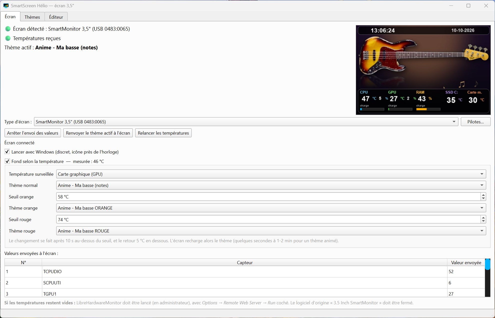
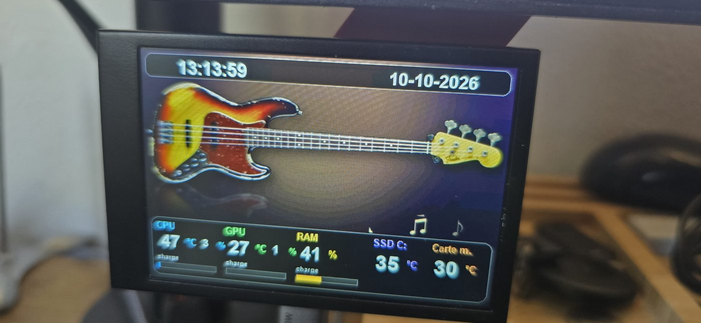
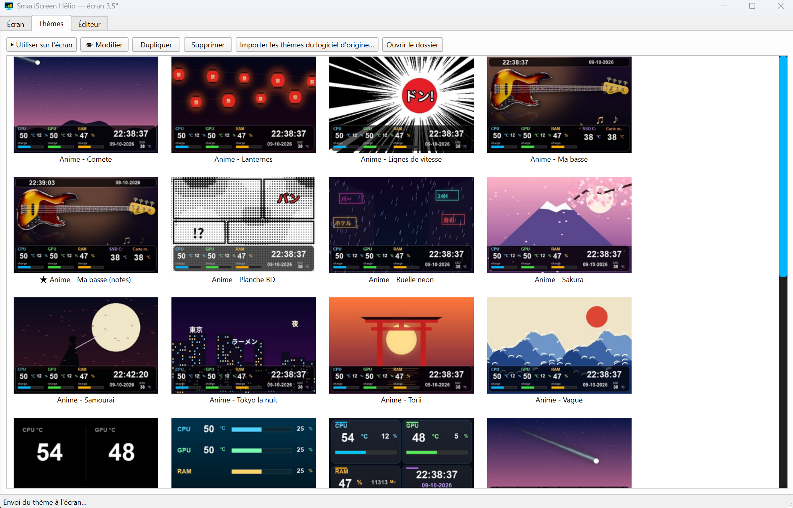
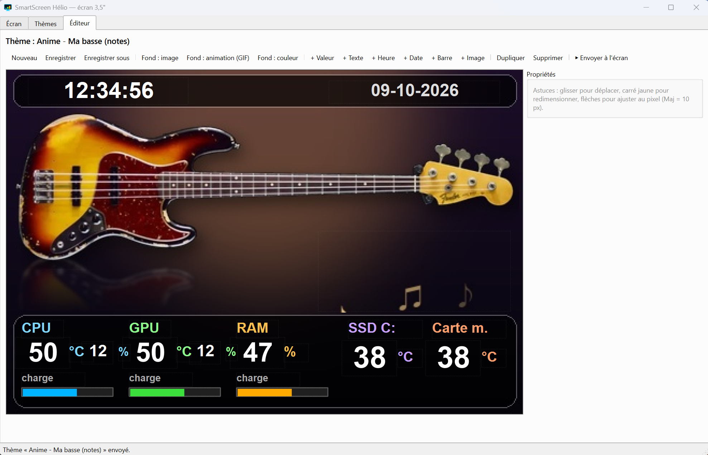

# SmartScreen Hélio

Logiciel libre pour Windows qui pilote les petits écrans USB 3,5" **« SmartMonitor »** (USB `0483:0065`) et affiche
en direct les températures et charges de ton PC : CPU, GPU, RAM, SSD, carte mère.

## Quel écran ?

*L'écran testé, avec le thème « Basse » (températures CPU, GPU, RAM, SSD, carte mère).*

Ce logiciel sert à un **mini écran PC USB de 3,5 pouces (IPS, 480 × 320)** qui affiche les températures et charges du PC.
On le trouve en ligne sous des noms comme « 3.5in IPS USB mini écran PC, affichage température AIDA64, moniteur CPU / RAM »
(recherche : *écran 3,5 pouces USB monitoring PC*, *mini écran température PC*, *SmartMonitor*, *USB mini display 3.5 inch AIDA64*).
Il coûte une vingtaine d'euros, se branche en USB (pas d'alimentation externe) et vient avec un petit pied.

- **Écran testé** : modèle vendu sous la marque « Hsthe Sea » (3,5" IPS, USB-C vers USB-A), identifiant USB `0483:0065`.
- **Comment vérifier le tien** : Gestionnaire de périphériques de Windows, ton écran branché, puis propriétés du périphérique,
  Détails, « ID de matériel » : tu dois lire `VID_0483&PID_0065`.
- **Pourquoi ce logiciel ?** Le logiciel d'origine de ces écrans est en anglais/chinois et peu pratique ; SmartScreen Hélio le remplace
  par un logiciel libre en français, avec galerie de thèmes, éditeur et fond qui change de couleur selon la température.
- D'autres écrans (AX206, Turing, XuanFang, Kipye, WeAct) sont reconnus mais **non testés**.

Les marques citées appartiennent à leurs propriétaires ; aucun lien avec les vendeurs ou fabricants.

## Téléchargement

➡️ **[Télécharger la dernière version](../../releases/latest)** (fichier `SmartScreenHelio_Setup_1.0.exe`)

Double-clic sur l'installateur : il installe le logiciel et Libre Hardware Monitor (les températures),
crée le raccourci sur le Bureau et peut les lancer avec Windows. Windows 10 ou 11.

### Avertissement Windows à l'installation (normal)
L'installateur n'est pas signé avec un certificat payant. Windows peut afficher **« Windows a protégé votre ordinateur »**
et certains antivirus peuvent le signaler à tort (faux positif courant avec les programmes Python empaquetés).
1. Clique sur **Informations complémentaires**, puis **Exécuter quand même**.
2. Pour que les températures fonctionnent, fais un **clic droit sur l'installateur, puis « Exécuter en tant qu'administrateur »**.

Le code est entièrement ouvert dans ce dépôt : tu peux le lire, ou compiler l'installateur toi-même (`packaging\build.bat`).

## Aperçu

## Fonctions
- Plus de 70 thèmes (dont des thèmes animés) et un éditeur glisser-déposer 480 × 320.
- Capteurs via Libre Hardware Monitor, avec secours Windows (CPU %, RAM, réseau).
- Fond qui change de couleur selon la température (normal, orange dès 60 °C, rouge dès 80 °C) : option à activer.
- Bouton « Relancer les températures », liens vers les pilotes, discret près de l'horloge.
- Autres écrans reconnus automatiquement (non testés) : AX206, Turing, XuanFang, Kipye, WeAct.

## Installation à la main
Python 3.10+, puis `install.bat`. Ferme d'abord le logiciel d'origine de l'écran.

## Vie privée et sécurité
Le logiciel ne collecte aucune donnée personnelle et ne contacte aucun serveur : tout reste sur ton PC.
Il n'installe aucun pilote système. Seule modification système : l'option « Lancer avec Windows » (désactivable).
Libre Hardware Monitor doit tourner en administrateur pour lire les températures.

## Limites connues
Protocole obtenu par rétro-ingénierie. Chaque changement de thème recharge l'écran en entier
(quelques secondes à plus de 30 s selon le thème). Testé sur un seul exemplaire d'écran : retours bienvenus (Issues).

## Licence et crédits
**GPL-3.0** (voir `LICENSE.txt`). Pilotes et compilateur de thèmes basés sur
[mathoudebine/turing-smart-screen-python](https://github.com/mathoudebine/turing-smart-screen-python)
et [Agentry433/turing-smart-screen-python-HIDdev2](https://github.com/Agentry433/turing-smart-screen-python-HIDdev2).
[Libre Hardware Monitor](https://github.com/LibreHardwareMonitor/LibreHardwareMonitor) (MPL-2.0) est installé à part.
Aucun lien avec les fabricants des écrans.

© 2026 Hélio — logiciel gratuit, sans publicité.
Un problème, une idée ? Ouvre un ticket dans l'onglet **Issues** de ce dépôt.
